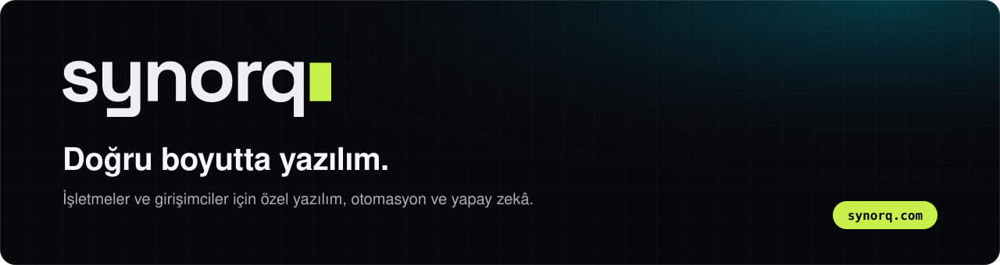
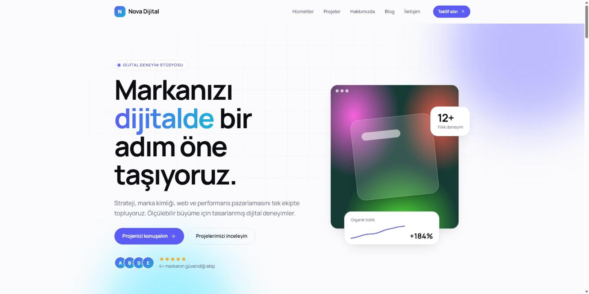
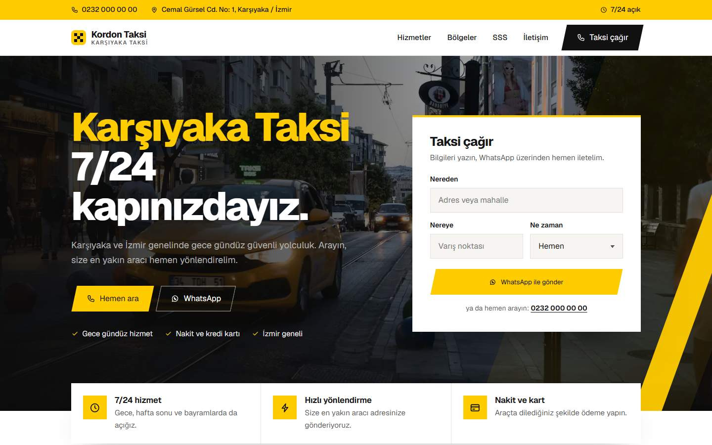
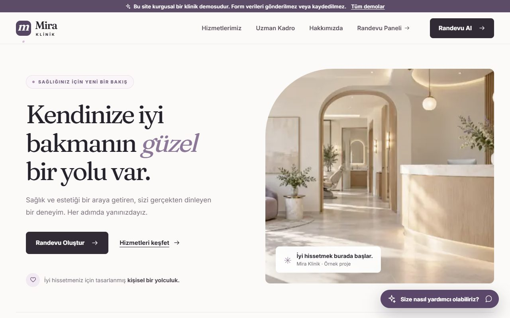
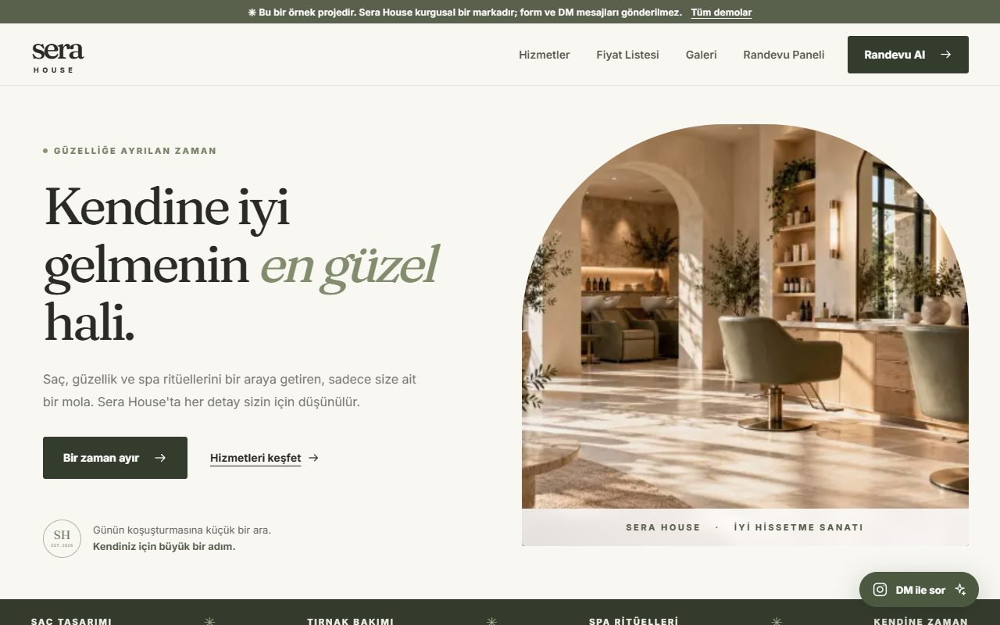
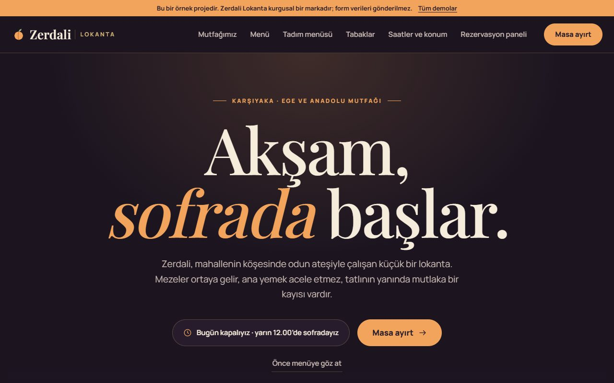
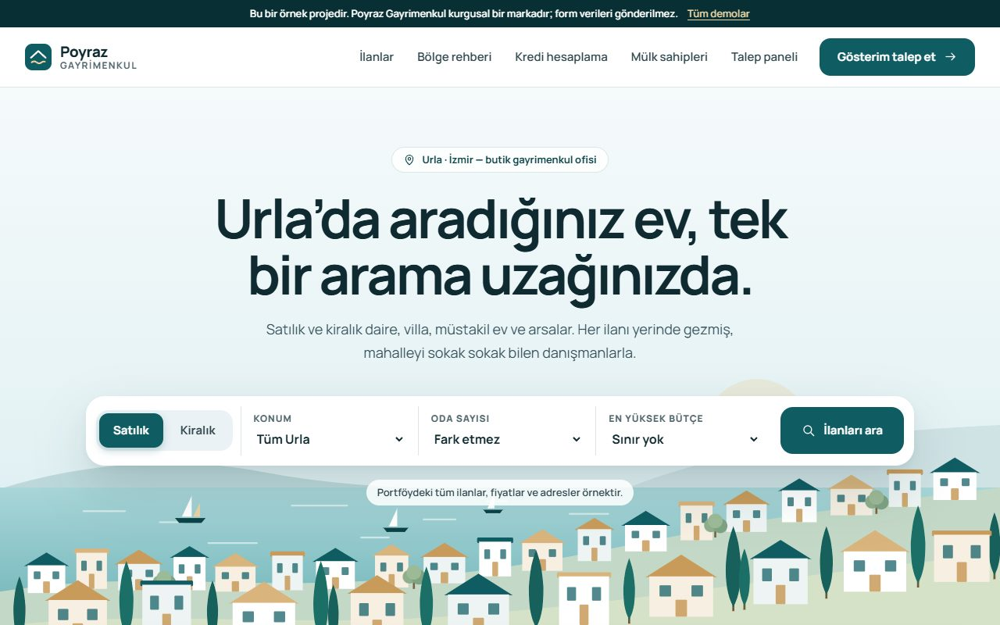
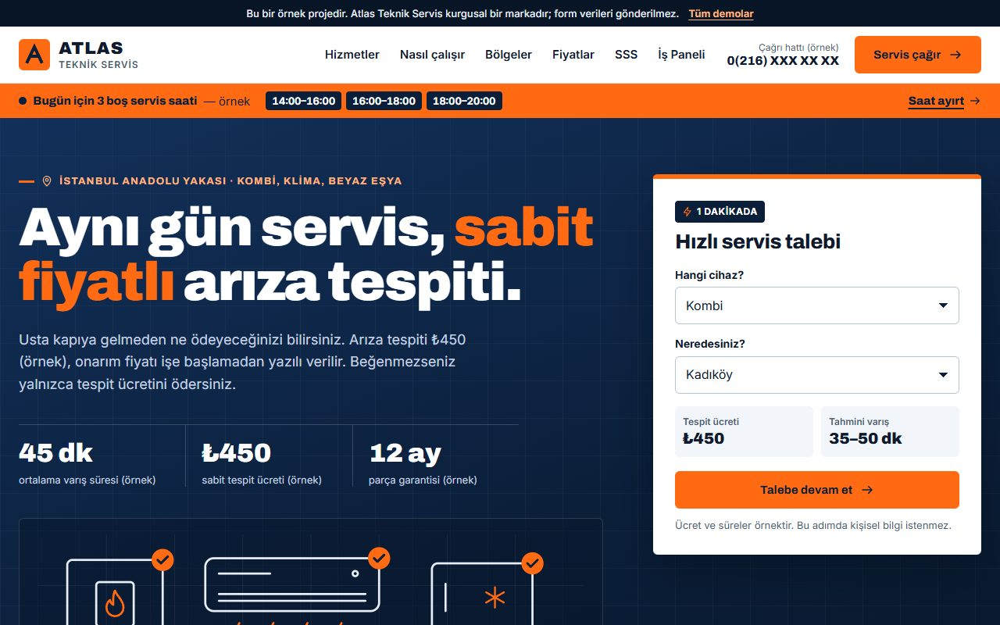
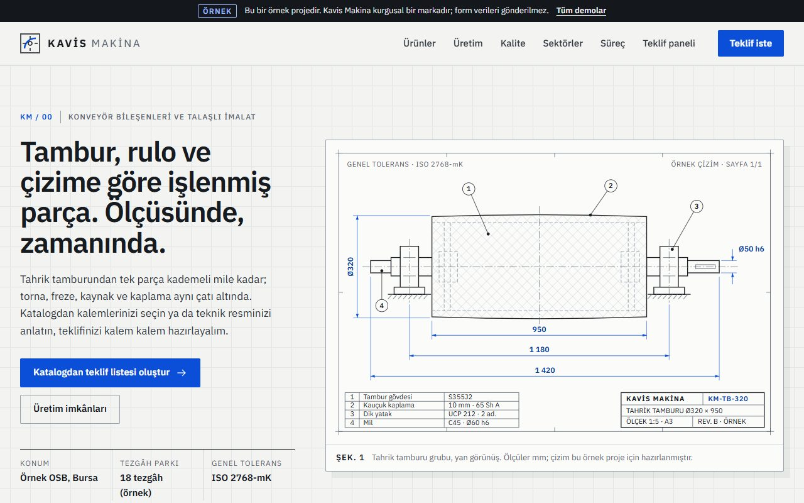

 

### Merhaba, ben Tarık Çelik

**[Synorq](https://synorq.com)**'un kurucusu ve geliştiricisiyim. Yerel işletmeler, B2B hizmet şirketleri ve girişimciler için özel yazılım, otomasyon ve yapay zekâ çözümleri geliştiriyorum. Veri modelinden arayüze, testten canlıya çıkışa kadar işin tamamını üstleniyorum.

## Synorq ne yapar?

Önce işi anlarız, sonra gereken kadarını yaparız. Gereğinden büyük altyapı da yok, çöpe gidecek bir ilk sürüm de.

| Kimin için | Ne kurarız | Başlangıç paketi |
| --- | --- | --- |
| **Yerel işletmeler** Restoran, klinik, salon, perakende, eğitim kurumu | Online randevu ve sipariş sistemi, WhatsApp otomasyonu, günün işlerini gösteren sade panel | [İşletme Sistemi](https://synorq.com/tr/hizmetler#yerel-isletmeler) |
| **B2B hizmet şirketleri** Teknik servis, ajans, danışmanlık, mühendislik, toptan satış | Teklif ve iş takip sistemi, raporlama, entegrasyonlar | [Süreç Otomasyonu](https://synorq.com/tr/hizmetler#b2b) |
| **Girişimciler** Fikri olan veya erken aşamadaki kurucular | MVP, ürün tasarımı, teknik danışmanlık | [MVP Sprinti](https://synorq.com/tr/hizmetler#girisimciler) |

Ayrıntılar: [Online randevu sistemi](https://synorq.com/tr/hizmetler/randevu-sistemi) · [Online sipariş sistemi](https://synorq.com/tr/hizmetler/siparis-sistemi) · [WhatsApp otomasyonu](https://synorq.com/tr/hizmetler/whatsapp-otomasyonu) · [Teklif ve iş takip programı](https://synorq.com/tr/hizmetler/teklif-ve-is-takip-programi)

## Hazır yazılımlar ve scriptler

İşletmeniz veya topluluğunuz için kendi markanızla kullanabileceğiniz yazılımlar. Ürün sayfalarında özellikleri, teknik gereksinimleri ve mevcut ekran görüntülerini inceleyebilirsiniz. Demo, fiyat ve kurulum kapsamı için [iletişime geçin](https://synorq.com/tr/iletisim).

<table>
<tr>
<td width="50%" valign="top"> <b>Emlak Ofisi</b> İlan sitesi, müşteri takibi, takvim ve raporlar. <a href="https://github.com/redsteelhat/emlak-ofisi-scripti">Ürünü ve 25 ekran görüntüsünü incele →</a></td>
<td width="50%" valign="top"> <b>PairPad</b> Solana token keşfi, canlı veriler ve token sayfaları. <a href="https://github.com/redsteelhat/pairpad-scripti">Ürünü incele →</a></td>
</tr>
<tr>
<td width="50%" valign="top"> <b>Ajans ve Kurumsal Site</b> Dört tema, içerik paneli ve tarayıcıdan kurulum. <a href="./urunler/ajans-kurumsal-scripti">Temaları ve paneli incele →</a></td>
<td width="50%" valign="top"> <b>Taksi Sitesi</b> Telefon, WhatsApp talep formu ve bölge sayfaları. <a href="./urunler/taksi-scripti">Siteyi ve paneli incele →</a></td>
</tr>
</table>

### Tüm scriptler

| Ürün | Kullanım alanı | Altyapı |
| --- | --- | --- |
| [Emlak Ofisi](https://github.com/redsteelhat/emlak-ofisi-scripti) | İlan yayınlama, CRM, takvim ve raporlar | Laravel · PHP |
| [PairPad](https://github.com/redsteelhat/pairpad-scripti) | Solana token keşfi, canlı veriler ve cüzdan bağlantısı | Next.js · TypeScript |
| [Ajans ve Kurumsal Site Scripti](./urunler/ajans-kurumsal-scripti) | Ajanslar, danışmanlık firmaları ve şirketler için dört temalı kurumsal web sitesi ve içerik yönetim paneli. | PHP 8.1+ · MySQL / MariaDB |
| [Taksi Sitesi Scripti](./urunler/taksi-scripti) | Taksi durakları için telefon aramasına ve WhatsApp üzerinden taksi talebine odaklanan web sitesi. | Node.js 20+ · JSON içerik dosyası |
| [Kombi ve Teknik Servis Scripti](./urunler/kombi-teknik-servis-scripti) | Kombi, klima ve beyaz eşya servisleri için kurumsal site, servis talepleri, teknisyen paneli ve işletme yönetimi. | Laravel 10 · PHP 8.1+ |
| [Kuş İlan Scripti](./urunler/kus-ilan-scripti) | Satılık ve sahiplendirme ilanları için üyelik, fotoğraf galerisi, filtreleme ve ilan onayı içeren ilan platformu. | Laravel 12 · PHP 8.2+ |
| [Oto Servis Yönetim Scripti](./urunler/oto-servis-scripti) | Araç kabulünden iş emrine, tahsilattan bakım hatırlatmasına kadar oto servis iş akışını yöneten uygulama. | Node.js ekosistemi · PostgreSQL |
| [Hesap ve Dijital Ürün Satış Scripti](./urunler/hesap-satis-scripti) | Tek satıcılı dijital ürün mağazası: katalog, stok, bakiye, sipariş ve anında teslim akışı. | Laravel 12 · PHP 8.2+ |
| [Forum Scripti](./urunler/forum-scripti) | Meclis temalı topluluk forumu: konular, cevaplar, anketler, mesajlaşma ve moderasyon. | Laravel 12 · PHP 8.2+ |
| [Hosting Satış Scripti](./urunler/hosting-satis-scripti) | Hosting, domain ve ek hizmet satışını; müşteri bakiyesini, yenilemeleri ve destek taleplerini yöneten sistem. | Laravel 12 · PHP 8.2+ |
| [Sözlük Scripti](./urunler/sozluk-scripti) | Başlık ve entry tabanlı topluluk sitesi: gündem, yazar profilleri, çaylak sistemi ve moderasyon. | Laravel 12 · PHP 8.2+ |
| [Medya İndirme Scripti](./urunler/medya-indirme-scripti) | Sosyal medya bağlantılarından indirme akışını üyelik, ücretsiz hak, bakiye ve yönetim paneliyle sunan uygulama. | Laravel 12 · PHP 8.2+ |
| [Villa Kiralama Scripti](./urunler/villa-kiralama-scripti) | Tek işletmenin birden fazla villasını listelediği; müsaitlik, sezon fiyatı ve rezervasyon taleplerini yönettiği kiralama sistemi. | Laravel 12 · PHP 8.2+ |
| [İnşaat ve Proje Yönetimi](./urunler/insaat-yonetim-scripti) | Kurumsal site, teklifler ve proje kayıtları; demo doğrulaması bekliyor | Laravel · PHP |

Tanıtım sayfaları uygulama kaynak kodu içermez. Paket, lisans, kurulum ve destek kapsamı ürün bazında görüşülür.

## Ürünler ve projeler

| Proje | Ne olduğu | Teknoloji |
| --- | --- | --- |
| [**Synorq Saha**](https://github.com/redsteelhat/synorq-saha) | Teknik servis firmaları için saha servis yönetimi: iş emri, teknisyen ataması, müşteri bilgilendirme. Geliştirme aşamasında. | Next.js · TypeScript · Supabase |
| [**BilardoGo**](https://github.com/redsteelhat/bilardogo-demo) | Bilardo oyuncularını ve salonlarını buluşturan PWA: salonda kimler var, rakip bulma, QR ile masaya bağlanma, işletme paneli. | Next.js · tRPC · Drizzle · Supabase |
| [**Oto Yedek Parça**](https://github.com/redsteelhat/oto-yedek-parca) | Çok mağazalı yedek parça e-ticaret platformu: araç uyumluluk filtresi, canlı destek, XML tedarikçi entegrasyonları. | Laravel · MySQL · Tailwind CSS |

## Sektör web paketleri

Altı sektör için hazırladığımız web sitesi paketlerinin çalışan örnekleri. Her biri bir site ve ona bağlı yönetim panelinden oluşur. Markalar kurgusaldır; müşteri işi değildir.

<table>
  <tr>
    <td width="33%" valign="top">
      
       <b>Klinik</b> · Mira Klinik
       <a href="https://synorq-demos.vercel.app/klinik">Site</a> · <a href="https://synorq-demos.vercel.app/klinik/panel">Panel</a>
    </td>
    <td width="33%" valign="top">
      
       <b>Kuaför ve güzellik</b> · Sera House
       <a href="https://synorq-demos.vercel.app/salon">Site</a> · <a href="https://synorq-demos.vercel.app/salon/panel">Panel</a>
    </td>
    <td width="33%" valign="top">
      
       <b>Restoran</b> · Zerdali Lokanta
       <a href="https://synorq-demos.vercel.app/restoran">Site</a> · <a href="https://synorq-demos.vercel.app/restoran/panel">Panel</a>
    </td>
  </tr>
  <tr>
    <td width="33%" valign="top">
      
       <b>Emlak</b> · Poyraz Gayrimenkul
       <a href="https://synorq-demos.vercel.app/emlak">Site</a> · <a href="https://synorq-demos.vercel.app/emlak/panel">Panel</a>
    </td>
    <td width="33%" valign="top">
      
       <b>Teknik servis</b> · Atlas Teknik Servis
       <a href="https://synorq-demos.vercel.app/servis">Site</a> · <a href="https://synorq-demos.vercel.app/servis/panel">Panel</a>
    </td>
    <td width="33%" valign="top">
      
       <b>Üretim</b> · Kavis Makina
       <a href="https://synorq-demos.vercel.app/uretim">Site</a> · <a href="https://synorq-demos.vercel.app/uretim/panel">Panel</a>
    </td>
  </tr>
</table>

Paketlerin kapsamı: [synorq.com/tr/hizmetler](https://synorq.com/tr/hizmetler#web-paketleri)

## Nasıl çalışırım

- **Doğru boyut.** İşi taşıyacak en sade mimariyi seçerim; ihtiyaç büyüdükçe sistem de büyür.
- **Ürün sizindir.** Kodu ve hesapları müşterinin adına kurarım. Kilitlenme yok, devir teslim açık.
- **Canlıya kadar.** Test, yayın ve izleme işin parçasıdır; teslimden sonraya bırakılmaz.

## Kullandığım araçlar

`TypeScript` `Next.js` `React` `Node.js` `PostgreSQL` `Supabase` `Drizzle` `tRPC` `Tailwind CSS` `Laravel` `Python` `Playwright` `Vitest` `Vercel`

<b>English</b>

 

I'm the founder and engineer of **[Synorq](https://synorq.com)**, a founder-led software studio based in Türkiye. *Right-sized software:* custom software, automation and AI tools for local businesses, B2B service companies and early-stage founders, built to the size of the problem.

- **Local businesses:** online booking and ordering systems, WhatsApp automation, a simple daily panel
- **B2B service companies:** quoting and job tracking systems, reporting, integrations
- **Founders:** MVPs, product design, technical advice

The six sector sites above are working samples built for fictional brands, each with a public site and a management panel.

Explore the product catalog above for real estate, agency websites, taxi stands, technical and auto services, classifieds, digital commerce, hosting, forums, dictionaries, media downloads and villa rentals. Product pages describe scope, requirements and available screenshots. Contact Synorq for demos, delivery and licensing.

Have a project in mind? Reach me at **[synorq.com](https://synorq.com/tr/iletisim)** or **contact@synorq.com**.

