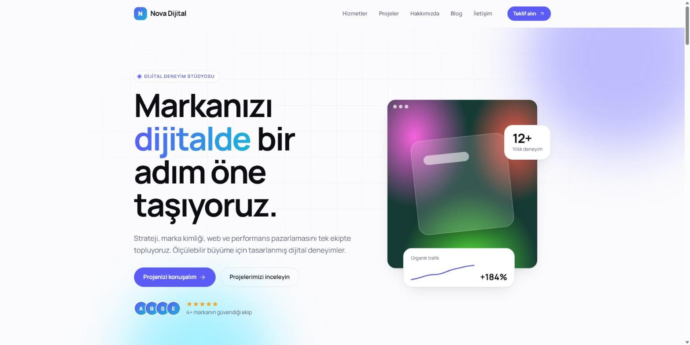
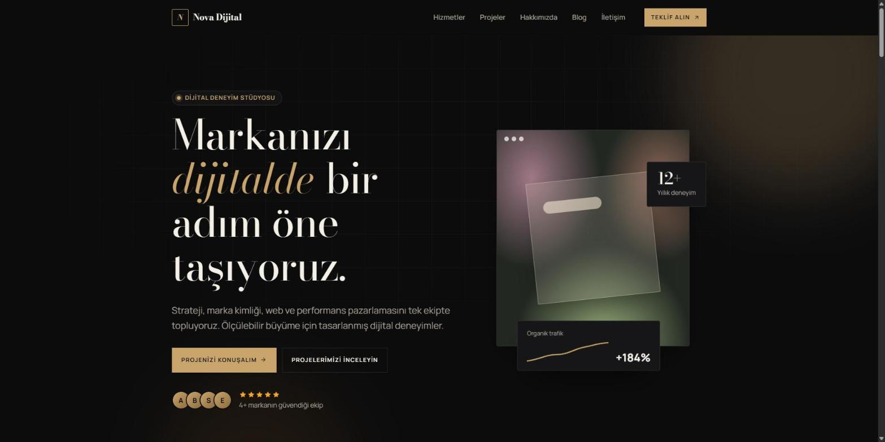
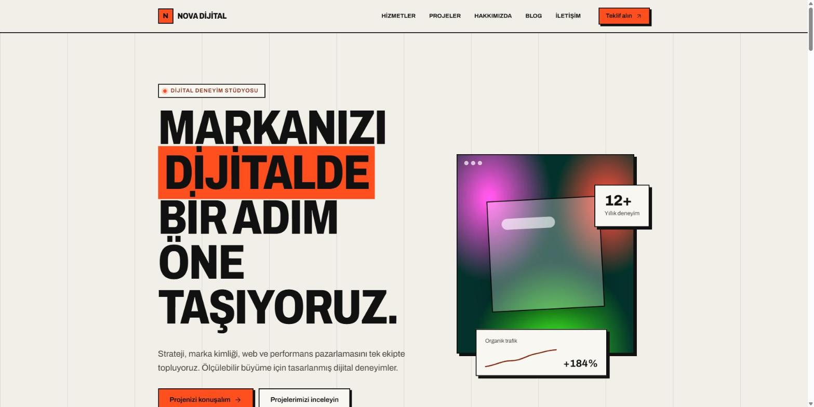
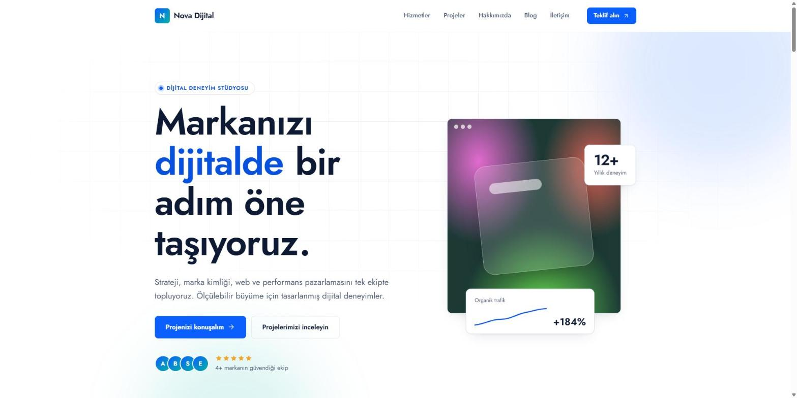
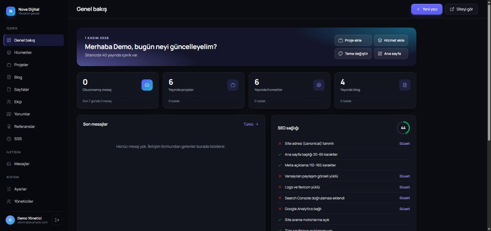
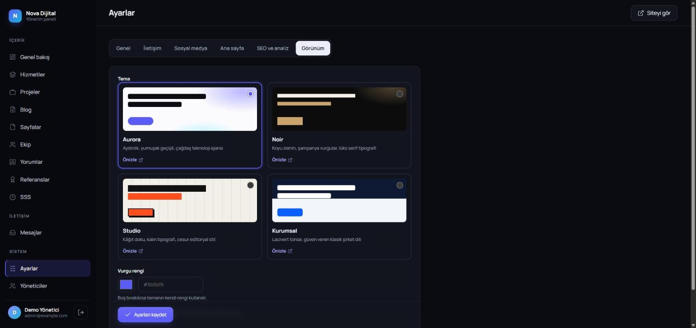
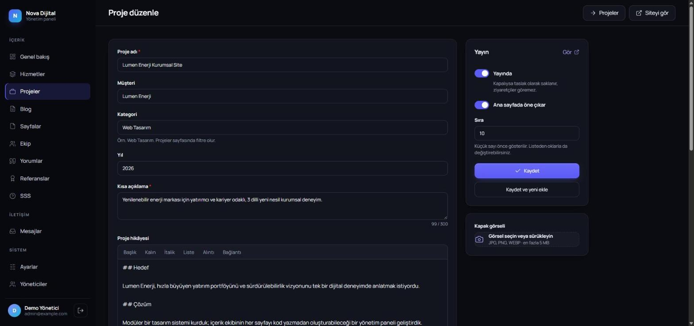

<h1 align="center">Ajans ve Kurumsal Site Scripti</h1>

Ajanslar, danışmanlık firmaları ve şirketler için dört temalı kurumsal web sitesi ve içerik yönetim paneli.

<a href="https://synorq.com/tr/iletisim">Demo ve fiyat bilgisi</a> · <a href="mailto:contact@synorq.com">contact@synorq.com</a>

## Kimin için?

Hizmetlerini ve projelerini kendi markasıyla sunmak, site içeriğini kod yazmadan güncellemek isteyen işletmeler.

## Öne çıkanlar

- Aurora, Noir, Studio ve Kurumsal: dört farklı tasarım; panelden tema ve vurgu rengi seçimi.
- Hizmet, proje, blog, ekip, referans, müşteri yorumu, SSS ve sayfa yönetimi.
- Sayfa bazında SEO alanları, Google sonuç önizlemesi ve SEO sağlık listesi.
- İletişim mesaj kutusu, CSV dışa aktarma ve e-posta bildirimi.
- Tarayıcıdan kurulum sihirbazı; Composer veya Node.js gerektirmeyen dağıtım.

## Ekran görüntüleri

### tema aurora

### tema noir

### tema studio

### tema kurumsal

### panel genel bakis

### panel temalar

### panel icerik duzenle

## Teknik altyapı

PHP 8.1+ · MySQL / MariaDB · Apache

## Kapsam ve gereksinimler

PHP ve MySQL destekleyen hosting gerekir. SEO sonuçları içerik, sunucu ve yapılandırmaya bağlıdır.

## Demo, kurulum ve satın alma

Demo erişimi, fiyat, kurulum kapsamı, özelleştirme ve lisans koşulları için **[Synorq ile iletişime geçin](https://synorq.com/tr/iletisim)** veya **[contact@synorq.com](mailto:contact@synorq.com)** adresine ürün adını belirterek yazın.

Bu depo ürün tanıtımı içindir; uygulamanın kaynak kodunu içermez. Teslim edilecek paket ve destek kapsamı teklif sırasında netleştirilir.
