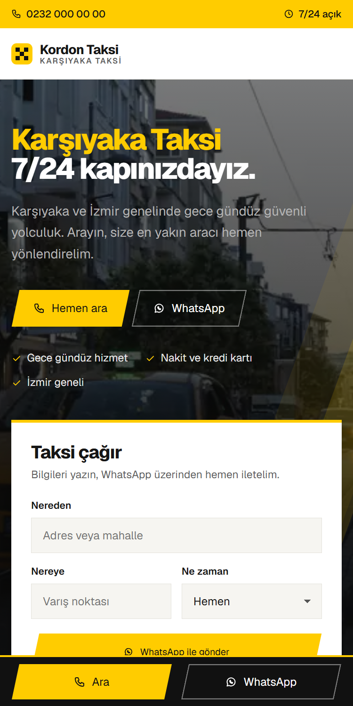
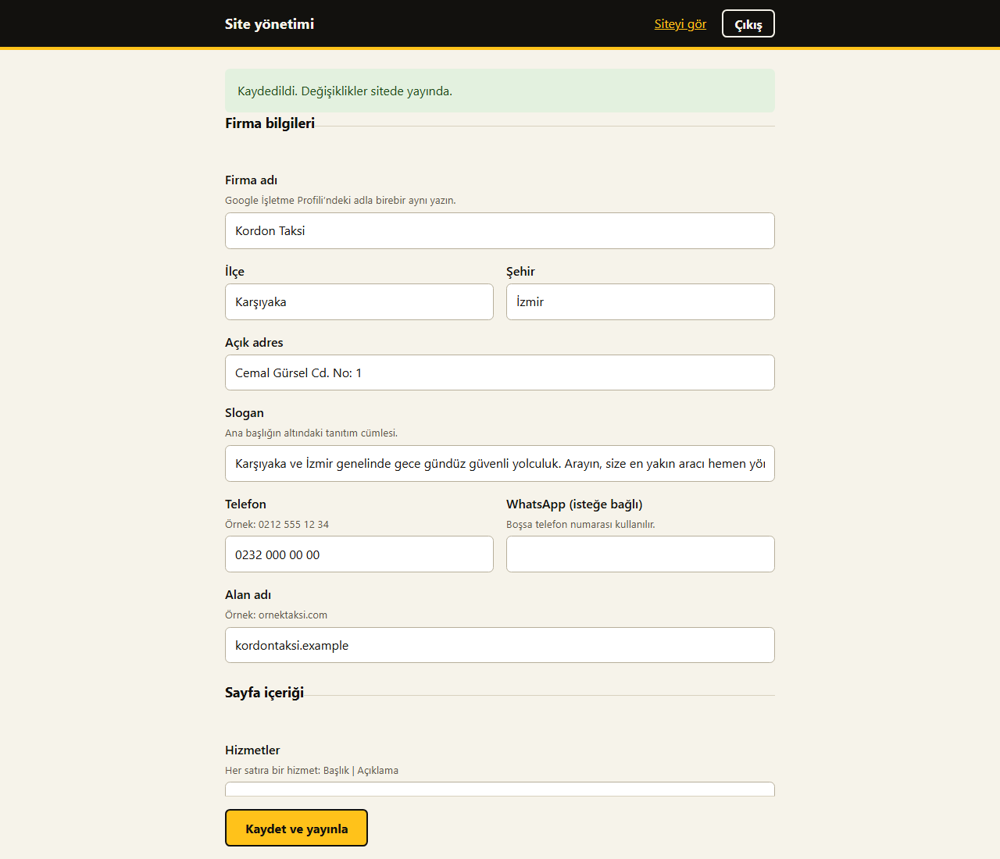

<h1 align="center">Taksi Sitesi Scripti</h1>

Taksi durakları için telefon aramasına ve WhatsApp üzerinden taksi talebine odaklanan web sitesi.

<a href="https://synorq.com/tr/iletisim">Demo ve fiyat bilgisi</a> · <a href="mailto:contact@synorq.com">contact@synorq.com</a>

## Kimin için?

Hizmet bölgelerini tanıtmak ve mobil ziyaretçiyi doğrudan telefon ya da WhatsApp iletişimine yönlendirmek isteyen taksi durakları.

## Öne çıkanlar

- Tek dokunuşla arama, WhatsApp ve mobilde sabit iletişim çubuğu.
- Nereden, nereye ve zaman alanlarını hazır WhatsApp mesajına dönüştüren talep formu.
- Özgün içerikli hizmet bölgesi sayfaları, yerel işletme verisi ve site haritası.
- Firma, iletişim, hizmet, bölge ve SSS içeriklerini düzenleyen şifreli yönetim paneli.
- Müşteriye sunum için demo modu; WebP görseller ve sunucuda hazırlanan sayfalar.

## Ekran görüntüleri

### masaustu

### mobil

### admin

## Teknik altyapı

Node.js 20+ · JSON içerik dosyası · Harici paket ve veritabanı gerektirmez

## Kapsam ve gereksinimler

WhatsApp üzerinden talep oluşturur; araç/şoför dağıtım sistemi değildir. Kalıcı Node.js süreci ve yazılabilir disk gerekir.

## Demo, kurulum ve satın alma

Demo erişimi, fiyat, kurulum kapsamı, özelleştirme ve lisans koşulları için **[Synorq ile iletişime geçin](https://synorq.com/tr/iletisim)** veya **[contact@synorq.com](mailto:contact@synorq.com)** adresine ürün adını belirterek yazın.

Bu depo ürün tanıtımı içindir; uygulamanın kaynak kodunu içermez. Teslim edilecek paket ve destek kapsamı teklif sırasında netleştirilir.
